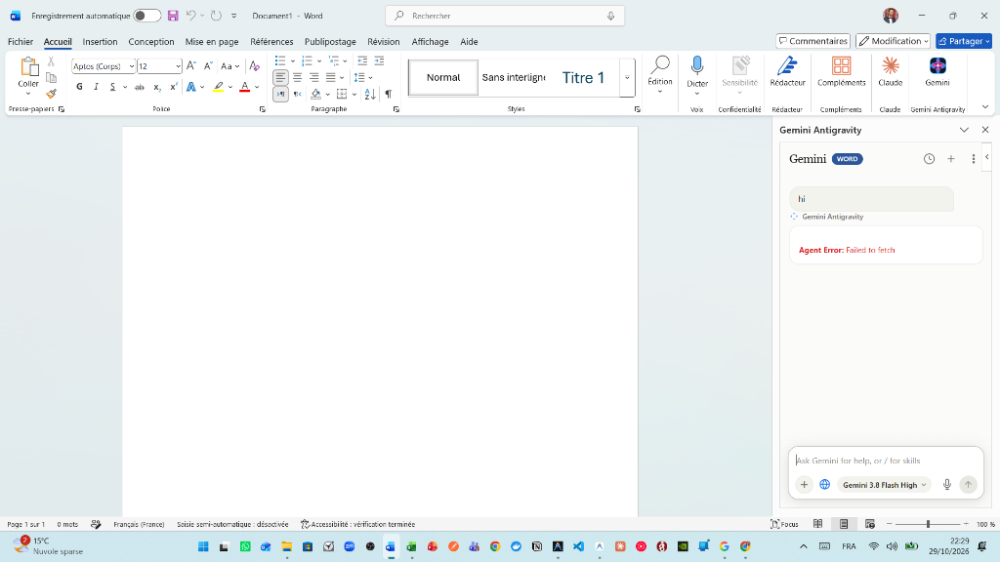
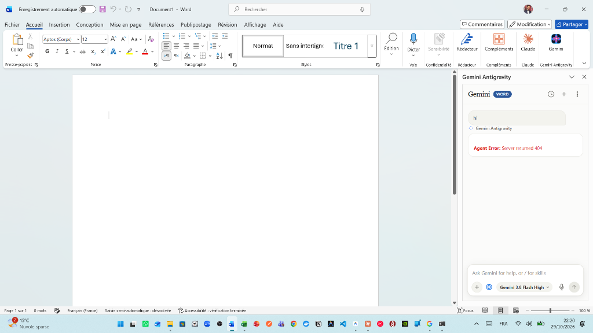

# Gemini Antigravity Microsoft Office Plugin

[](LICENSE)
[](https://github.com/HassenChaaben/Micosoft_office_google_antigravity_plugin)
[](https://python.org)
[](https://fastapi.tiangolo.com)
[](https://github.com/HassenChaaben/Micosoft_office_google_antigravity_plugin/releases)

Autonomous, publication-grade AI Copilot for **Microsoft Word**, **Microsoft PowerPoint**, and **Microsoft Excel**, powered by **Google Gemini** and the **Antigravity** cognitive runtime.

> 🔗 **Repository**: [https://github.com/HassenChaaben/Micosoft_office_google_antigravity_plugin.git](https://github.com/HassenChaaben/Micosoft_office_google_antigravity_plugin.git)  
> 📦 **Download Standalone Setup**: [Releases / GeminiAntigravityOffice_Setup.exe](https://github.com/HassenChaaben/Micosoft_office_google_antigravity_plugin/releases)

---

## 📸 Screenshots & Visual Walkthrough

### 1. Microsoft Word Ribbon Integration & Active Taskpane
Directly embedded inside Microsoft Word with a dedicated **Gemini** button on the Home (Accueil) tab and real-time streaming taskpane:



### 2. Autonomous Taskpane Experience
Clean, modern conversational interface supporting multimodal inputs, slash skills (`/check-doc`, `/copy-edit`, etc.), and live step-by-step tool execution:



### 3. Local High-Performance Daemon Server
Localhost HTTPS background daemon (`https://127.0.0.1:18890`) providing Win32 COM automation, MCP bridges, and zero-latency communication:


---

## ⚡ What We Have Built

Gemini Antigravity is an autonomous Office agent that operates directly on document objects rather than just returning markdown text. It bridges the modern **Google Gemini** model family with native desktop Office applications via a local background daemon.

### 1. Autonomous Microsoft Word Agent (`daemon/office/`)
- **Perceive-First Loop**: Automatically inspects document structure, paragraph count, tables, headings, and active cursor selection *before* sending prompts to the model.
- **Native Table Insertion (`word_insert_table`)**: Creates publication-grade Word tables with specified headers, row counts, and auto-formatting without creating phantom duplicates.
- **In-Place Paragraph Editing (`word_set_paragraph_text`, `word_replace_text`)**: Edits existing paragraphs directly in place, preventing unwanted duplicate blocks when refining documents.
- **Form Field Filling (`word_fill_form_fields`)**: Identifies label-value pairs and template cells, filling adjacent cells automatically.
- **Real-Time Stop & Cancel**: Immediate task cancellation via the UI `⏹ Stop` button or the `Esc` keyboard shortcut.

### 2. AI Text-to-Image Generation (Gemini Imagen 3)
- **Zero-Subscription Default**: The plugin defaults to your active Antigravity subscription runtime.
- **Imagen 3 Integration (`word_generate_image`)**: Users can input their personal Gemini API key in Settings to unlock direct AI image generation. The agent creates the illustration and inserts it directly into Word with automatic captions and alignment.

### 3. Multimodal Prompt Picture Attachments
- **Clipboard Screenshots (`Ctrl+V`)**: Take a screenshot with `Win + Shift + S` and paste it directly into the prompt box.
- **Photo Picker (`#btnAttachPhoto`)**: Attach `.png`, `.jpg`, `.webp`, `.gif`, or `.bmp` files.
- **Drag & Drop**: Drop images straight onto the input dock card.
- **Local Persistence & Injection**: Attachments are saved to `%LOCALAPPDATA%\GeminiAntigravityOffice\attachments\` and fed directly into the model's prompt for inspection, analysis, or insertion via `word_insert_image`.

### 4. Turnkey Client Architecture
- **Local HTTPS Daemon (`gemini_office_daemon.exe`)**: Self-contained background service compiled with PyInstaller. Runs on port `18890` with auto-generated and pre-trusted Windows root SSL certificates.
- **Office WEF Sideloading (`wef_register.ps1`)**: Automatically registers the manifest across Word, PowerPoint, and Excel across all Windows UI locales (`en-US`, `fr-FR`, `it-IT`, `de-DE`, `es-ES`).
- **Windows Startup**: Automatically launches silently on Windows user logon via `HKCU\...\Run`.

---

## 🔍 Exact Capabilities & What is Missing (Zero-Fluff Matrix)

To provide total clarity on what this tool currently does and what remains on the roadmap:

| Capability | Status | Implementation Details |
|---|:---:|---|
| **Microsoft Word COM Automation** | ✅ Production | Paragraph rewrites, tables, formatting, styles, outline inspection |
| **Multimodal Image Prompt Attachments** | ✅ Production | Clipboard paste (`Ctrl+V`), photo picker, drag & drop, local caching |
| **Gemini Imagen 3 Image Generation** | ✅ Production | Activated when user enters Gemini API key in Settings |
| **Live Streaming & Task Interruption** | ✅ Production | Real-time SSE token delivery with `⏹ Stop` button and `Esc` abort |
| **Word Ribbon Home Tab Integration** | ✅ Production | Permanent ribbon button across all installed Office language packs |
| **Offline Test Mock Mode** | ✅ Production | Mock responses for headless CI test suites (`GEMINI_OFFICE_BACKEND=offline`) |
| **One-Click Turnkey Windows Setup** | ✅ Production | Single 49 MB installer (`GeminiAntigravityOffice_Setup.exe`) |
| **Excel 3-Statement Financial Modeling** | ⚠️ Partial | Basic table output working; multi-sheet formula linkage in progress |
| **PowerPoint Executive Storylining** | ⚠️ Partial | Slide creation working; custom shape coordinate layout in progress |
| **macOS / Office Online (Web) Support** | ❌ Missing | Win32 COM is Windows-only; pure Office.js fallback required for macOS |
| **Cross-Window Multi-Document Sync** | ❌ Missing | Agent targets active foreground document; multi-doc switching in progress |

---

## 🚀 Quick Setup & Installation

### Option A: Install via Standalone Windows Setup *(Recommended)*

No Python, Node.js, or command line required:

1. **Download the Installer**:
   Download [`GeminiAntigravityOffice_Setup.exe`](https://github.com/HassenChaaben/Micosoft_office_google_antigravity_plugin/releases) from the **[Releases](https://github.com/HassenChaaben/Micosoft_office_google_antigravity_plugin/releases)** page.
2. **Run the Installer**:
   Double-click the setup wizard. It automatically:
   - Deploys the standalone daemon and web taskpane to `%LOCALAPPDATA%\GeminiAntigravityOffice`.
   - Generates and trusts the localhost TLS certificate.
   - Injects the add-in into Word, PowerPoint, and Excel ribbons.
   - Configures the background service to start on Windows logon.
3. **Launch Microsoft Word**:
   - Open Word (or double-click the **Gemini Antigravity Word** desktop shortcut).
   - In the top ribbon on the **Accueil** (or **Home**) tab, click the black **Gemini** icon button.
   - The taskpane will open and connect automatically.

---

### Option B: Build & Run from Source (Developers)

#### Prerequisites
- Windows 11 or Windows 10
- Python 3.12+
- Microsoft Office (Word 2016, 2019, 2021, or Microsoft 365)
- Inno Setup 6 (optional, to compile the `.exe` installer)

#### 1. Clone the Repository
```bash
git clone https://github.com/HassenChaaben/Micosoft_office_google_antigravity_plugin.git
cd Micosoft_office_google_antigravity_plugin
```

#### 2. Install Dependencies
```powershell
pip install -r requirements.txt
```

#### 3. Run Automated Tests
```powershell
# Run JavaScript Taskpane & Agent tests
node --test tests/js/taskpane-utils.test.mjs tests/js/word-agent.test.mjs

# Run Python Backend & Attachment tests
pytest tests/test_imagen_client.py tests/test_image_attachments.py -v
```

#### 4. Build Daemon & Installer
```powershell
powershell -ExecutionPolicy Bypass -File scripts/build.ps1
```
The output installer will be generated at:
`dist\GeminiAntigravityOffice_Setup.exe`

---

## 🤝 Open for Contribution

This project is **100% open-source** and actively welcomes community contributions!

We welcome pull requests for:
- 💡 **New Office Skills**: Adding specialized `/commands` for legal contracts, medical papers, or academic theses.
- 📊 **Excel Autonomous Modeling**: Enhancing formula graphs and financial statements.
- 🎨 **PowerPoint Slide Automation**: Richer slide layouts and visual themes.
- 🍎 **macOS & Web Office.js Compatibility**: Expanding pure Office.js fallback tools for cross-platform support.

### How to Contribute
1. Fork the repository: [https://github.com/HassenChaaben/Micosoft_office_google_antigravity_plugin](https://github.com/HassenChaaben/Micosoft_office_google_antigravity_plugin).
2. Create a feature branch: `git checkout -b feat/my-new-feature`.
3. Commit your changes: `git commit -m "feat: add support for custom chart themes"`.
4. Push to your fork and submit a **Pull Request**.

---

## 📄 License

Distributed under the **MIT License**. See `LICENSE` for more information.

---

<p align="center">
  <b>Gemini Antigravity Microsoft Office Plugin</b> • Created & Maintained by <a href="https://github.com/HassenChaaben">Hassen Ben Chaaben</a>
</p>
