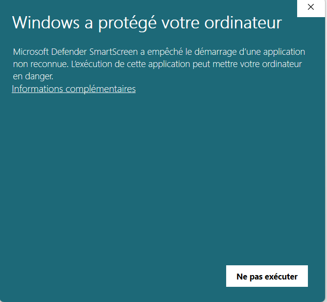
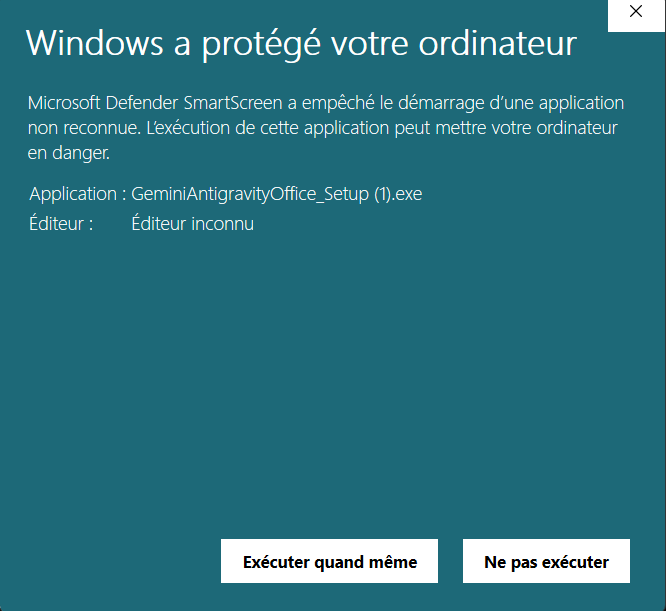

<p align="center">
  
</p>

<h1 align="center">Micosoft_office_google_antigravity_plugin</h1>

<p align="center">
  <b>An Autonomous AI Copilot for Microsoft Office connected with Antigravity</b><br>
  <i>An Open-Source Hobby Project inspired by Claude's Desktop Office Integration</i>
</p>

<p align="center">
  <a href="LICENSE"></a>
  <a href="https://github.com/HassenChaaben/Micosoft_office_google_antigravity_plugin"></a>
  <a href="https://python.org"></a>
  <a href="https://fastapi.tiangolo.com"></a>
  <a href="https://hassenchaaben.github.io/Micosoft_office_google_antigravity_plugin/"></a>
  <a href="https://github.com/HassenChaaben/Micosoft_office_google_antigravity_plugin/releases"></a>
</p>

> **Repository**: [https://github.com/HassenChaaben/Micosoft_office_google_antigravity_plugin](https://github.com/HassenChaaben/Micosoft_office_google_antigravity_plugin)  
> **Documentation Portal**: [https://hassenchaaben.github.io/Micosoft_office_google_antigravity_plugin/](https://hassenchaaben.github.io/Micosoft_office_google_antigravity_plugin/)  
> **Download Standalone Setup**: [GeminiAntigravityOffice_Setup.exe v1.0.0 (Direct Download)](https://github.com/HassenChaaben/Micosoft_office_google_antigravity_plugin/releases/latest/download/GeminiAntigravityOffice_Setup.exe)

> [!NOTE]
> **🎨 Open-Source Hobby Scope**: This project is developed strictly as a **personal open-source hobby and technical exploration**. It is **NOT built for commercial uses** or enterprise distribution.
>
> **💡 Problematic & Claude Inspiration**: Traditional Office AI assistants are limited to sidebar chat windows that generate markdown for manual copy-pasting. Inspired by **Claude's deep desktop and workspace integration into office tools**, this project allows an autonomous model to directly perceive document structure, edit paragraphs in-place without phantom duplicates, and generate native publication-grade tables and figures via local COM automation.
>
> **🌿 Community Contributions**: We warmly welcome open-source community contributions on the **`dev`** branch to expand automation to **Microsoft PowerPoint**, **Microsoft Excel**, and cross-platform **macOS** support!

---

## Visual Walkthrough & Real-World Use Cases

The following real-world screenshots demonstrate Gemini Antigravity operating live inside Microsoft Word on an executive technical dossier (*"Progetto di Automazione e Monitoraggio Esecutivo"*):

### 1. Executive Document Drafting & Publication-Grade Table Insertion
The user requests a comprehensive project delivery schedule. Gemini Antigravity perceives the document outline and inserts **Tabella 1** (*"Stato di avanzamento dei deliverable e della documentazione"*), populated with 6 records across 3 columns (`Elemento / Documento`, `Descrizione / Specifiche`, `Stato / Valore`), shaded header styling, automated column widths, and contextual narrative text without paragraph duplication:


### 2. Multi-Table Business & Financial Modeling
The user asks to expand the dossier with budget allocation and financial tracking. The agent builds **Tabella 2** (*"Ripartizione Budget ed Economica delle Fasi Operative"*), comparing planned estimates against actual costs with formatted currency numbers and harmonized grid formatting matching the document's design tokens:


### 3. Autonomous Process Flowcharts & Executive Visual Cards
Transforming raw tabular metrics into visual roadmap components. The agent generates **Figura 1** (*"Diagramma di flusso e avanzamento per fasi"*), creating a multi-stage visual process flow with milestone cards, KPI badges, and status colors directly rendered onto the Word canvas:


### 4. Multi-Turn Conversational Memory & Persistent Session Drawer
Iterative refinement across complex documents. The user opens the **"Your conversations"** session drawer in the taskpane to view conversation history (`"cretae a table of 3 colu..."`), switch sessions, remove phantom blank pages, re-index headings, and customize diagram palettes:


---

## Core Architecture & Capabilities

Gemini Antigravity is an autonomous Office agent that operates directly on document objects rather than just returning markdown text. It bridges the modern **Google Gemini** model family with native desktop Office applications via a local background daemon.

### 1. Autonomous Microsoft Word Agent (`daemon/office/`)
- **Perceive-First Loop**: Automatically inspects document structure, paragraph count, tables, headings, and active cursor selection *before* sending prompts to the model.
- **Native Table Insertion (`word_insert_table`)**: Creates publication-grade Word tables with specified headers, row counts, and auto-formatting without creating phantom duplicates.
- **In-Place Paragraph Editing (`word_set_paragraph_text`, `word_replace_text`)**: Edits existing paragraphs directly in place, preventing unwanted duplicate blocks when refining documents.
- **Form Field Filling (`word_fill_form_fields`)**: Identifies label-value pairs and template cells, filling adjacent cells automatically.
- **Real-Time Stop & Cancel**: Immediate task cancellation via the UI `⏹ Stop` button or the `Esc` keyboard shortcut.

### 2. AI Text-to-Image Generation (Gemini Imagen 3)
- **Zero-Subscription Default**: The plugin defaults to your active Antigravity subscription runtime.
- **Imagen 3 Integration (`word_generate_image`)**: Users can input their personal Gemini API key in Settings to unlock direct AI image generation. The agent creates the illustration and inserts it directly into Word with automatic captions and alignment.

### 3. Multimodal Prompt Picture Attachments
- **Clipboard Screenshots (`Ctrl+V`)**: Take a screenshot with `Win + Shift + S` and paste it directly into the prompt box.
- **Photo Picker (`#btnAttachPhoto`)**: Attach `.png`, `.jpg`, `.webp`, `.gif`, or `.bmp` files.
- **Drag & Drop**: Drop images straight onto the input dock card.
- **Local Persistence & Injection**: Attachments are saved to `%LOCALAPPDATA%\GeminiAntigravityOffice\attachments\` and fed directly into the model's prompt for inspection, analysis, or insertion via `word_insert_image`.

### 4. Turnkey Client Architecture
- **Local HTTPS Daemon (`gemini_office_daemon.exe`)**: Self-contained background service compiled with PyInstaller. Runs on port `18890` with auto-generated and pre-trusted Windows root SSL certificates.
- **Office WEF Sideloading (`wef_register.ps1`)**: Automatically registers the manifest across Word, PowerPoint, and Excel across all Windows UI locales (`en-US`, `fr-FR`, `it-IT`, `de-DE`, `es-ES`).
- **Windows Startup**: Automatically launches silently on Windows user logon via `HKCU\...\Run`.


---

## Engineering Capabilities & Reality Matrix

To provide total engineering clarity, every feature in Gemini Antigravity is classified under a strict maturity framework:

### Status Classification Criteria & Legend

| Badge | Classification | What This Means |
|---|---|---|
|  | **Production** | **Fully functional & verified**: Native Win32 COM automation is live in desktop Word. Covered by end-to-end automated test suites and packaged in the turnkey `.exe` installer. |
|  | **In Progress** | **Active core development**: Foundational COM and daemon endpoints exist, but full feature parity (e.g., linked formulas or vector shapes) is being implemented. **Tracked via open GitHub Project issues**. |
|  | **UI Blueprint** | **Visual design prototype**: Interface buttons, pills, and menus exist in the taskpane to establish UX patterns, but dynamic server-side execution sandboxes or third-party OAuth connectors are not yet connected. |
|  | **Not Supported** | **Architectural constraint**: Not currently supported due to platform boundaries (e.g. macOS lacking native Win32 COM APIs). Community proposals and pure Office.js fallbacks are welcome. |

### Capabilities Matrix & Issue Tracking

| Capability | Status | Implementation Details & Current Reality | GitHub Issue / Roadmap |
|---|:---:|---|:---:|
| **Microsoft Word Win32 COM Automation** |  | In-place rewrites, native table insertion, direct formatting, styles, outline inspection. | Verified Production |
| **Multimodal Image Prompt Attachments** |  | Clipboard paste (`Ctrl+V`), photo picker (`#btnAttachPhoto`), drag & drop, local caching in `%LOCALAPPDATA%`. | Verified Production |
| **Gemini Imagen 3 AI Image Generation** |  | Activated when user enters Gemini API key in Settings; inserts illustrations with captions. | Verified Production |
| **Live Streaming & Task Interruption** |  | Real-time SSE token delivery with `⏹ Stop` button and `Esc` keyboard abort. | Verified Production |
| **Word Ribbon Home Tab Integration** |  | Permanent ribbon button across all installed Office language packs (`en-US`, `fr-FR`, `it-IT`, `de-DE`, `es-ES`). | Verified Production |
| **Offline Test Mock Mode** |  | Mock responses for headless CI test suites (`GEMINI_OFFICE_BACKEND=offline`). | Verified Production |
| **One-Click Turnkey Windows Setup** |  | Single 51 MB installer (`GeminiAntigravityOffice_Setup.exe`) with auto-cert and auto-registry injection. | Verified Production |
| **Excel 3-Statement Financial Modeling** |  | Basic table output and cell formatting work; dynamic multi-sheet formula linkage is in progress. | [Issue #6: Excel Dynamic Modeling](https://github.com/HassenChaaben/Micosoft_office_google_antigravity_plugin/issues/6) |
| **PowerPoint Executive Storylining** |  | Slide creation and text boxes work; custom vector shape coordinate layout is in progress. | [Issue #7: PowerPoint Vector Layout](https://github.com/HassenChaaben/Micosoft_office_google_antigravity_plugin/issues/7) |
| **`/skills` Dynamic Skill Execution** |  | The 6 pills (`/check-doc`, `/copy-edit`, etc.) are **UI preview pills** only; no isolated server-side skill sandboxes exist yet. | [Roadmap Issue #8: Dynamic Skill Engine](https://github.com/HassenChaaben/Micosoft_office_google_antigravity_plugin/issues/8) |
| **`/plugins` & Custom Connectors Menu** |  | The flyout menu exists in the UI, but external third-party API connectors (GitHub, Jira, Notion) are **unconnected stubs**. | [Roadmap Issue #9: External Connectors](https://github.com/HassenChaaben/Micosoft_office_google_antigravity_plugin/issues/9) |
| **`search_web` Internet Research Tool** |  | The agent is **strictly offline/document-bound**; there is no live web search API integration connected. | [Roadmap Issue #10: Live Search Integration](https://github.com/HassenChaaben/Micosoft_office_google_antigravity_plugin/issues/10) |
| **macOS / Office Online (Web) Support** |  | Architecture relies strictly on native Windows Win32 COM and local Windows daemon IPC. | [RFC Issue #11: macOS & Web Support](https://github.com/HassenChaaben/Micosoft_office_google_antigravity_plugin/issues/11) |
| **Cross-Window Multi-Document Sync** |  | Agent targets active foreground document; multi-doc switching across separate windows is in progress. | [Backlog Issue #12: Multi-Document Context](https://github.com/HassenChaaben/Micosoft_office_google_antigravity_plugin/issues/12) |

---

### Detailed Breakdown of Incomplete & Stubbed Features

To ensure complete engineering transparency for contributors and users, here is exactly what is NOT yet functional:

#### 1. The `/skills` Pills Are UI Blueprints Only (No Dynamic Server Execution)
In the onboarding view of the taskpane, there are 6 clickable skill pill buttons:
- `/check-doc` (Review structure & formatting)
- `/copy-edit` (Enhance style & clarity)
- `/summarize-contract` (Legal clause overview)
- `/flag-issues` (Risk & discrepancy identification)
- `/industry-overview` (Market analysis draft)
- `/storylining` (Executive narrative structuring)

> [!WARNING]
> **Current Reality**: Clicking these buttons currently only pastes suggested starter text into `#promptInput`. There is **no dynamic server-side Python execution engine** that loads isolated skills from `daemon/skills/`. All requests are routed through the single monolithic `word_agent` / `gemini_client` prompt pipeline. PRs to introduce a modular skill runner are warmly welcomed!

#### 2. The `/plugins` & Connectors Menu Is a Non-Functional Prototype
In the input dock card, clicking the `+` flyout button displays a "Connectors" option (`#menuConnectors`) intended for third-party integrations (GitHub, Jira, Google Workspace, Notion).

> [!WARNING]
> **Current Reality**: This menu is currently a **visual mockup**. No backend API connectors exist to fetch remote files, synchronize issues, or query external tools. The agent currently only operates on the locally active Office document.

#### 3. The `search_web` Tool Is Not Connected
When the agent drafts scientific or business sections (e.g. the Quantum Computing overview on Page 5 of the sample document), users may expect live internet browsing or citations.

> [!WARNING]
> **Current Reality**: The agent currently has **no live search provider connected** (e.g., Google Custom Search API, Serper, or Tavily). The agent generates document text purely based on the LLM's parametric knowledge and the text extracted from the user's active document. Live web browsing and retrieval-augmented verification are planned for v1.1.0.

## Quick Setup & Installation

### Option A: Install via Standalone Windows Setup *(Recommended)*

No Python, Node.js, or command line required:

1. **Download the Installer**:
   Download [**GeminiAntigravityOffice_Setup.exe v1.0.0 (Direct Download)**](https://github.com/HassenChaaben/Micosoft_office_google_antigravity_plugin/releases/latest/download/GeminiAntigravityOffice_Setup.exe) or get it from the **[Releases](https://github.com/HassenChaaben/Micosoft_office_google_antigravity_plugin/releases)** page.
2. **Run the Installer**:
   Double-click `GeminiAntigravityOffice_Setup.exe`.
   
   > [!TIP]
   > **Windows Defender SmartScreen Notice**: Because this software is distributed as a free open-source hobby project without a paid corporate code-signing certificate, Windows Defender SmartScreen displays a blue protection window.
   > 
   > **To run the installer, follow these two quick steps:**
   > 1. In the first window, click **`Informations complémentaires`** (or **`More info`**):
   > 2. Then click **`Exécuter quand même`** (or **`Run anyway`**) at the bottom:
   >
   > <p align="center">
   >   
   >   &nbsp;&nbsp;
   >   
   > </p>
   >
   > Once clicked, the setup wizard runs with zero technical configuration:
   > - Deploys the standalone daemon and web taskpane to `%LOCALAPPDATA%\GeminiAntigravityOffice`.
   > - Generates and trusts the localhost TLS certificate in Windows Certificate Manager (`TrustedPeople`).
   > - Injects the add-in into Word, PowerPoint, and Excel ribbons across all installed languages.
   > - Configures the background service to start silently on Windows logon.
   > - *Note: If Microsoft Word was already running, close and reopen Word once so the new ribbon icon appears.*
3. **Launch Microsoft Word**:
   - Open Word (or double-click the **Gemini Antigravity Word** desktop shortcut).
   - In the top ribbon on the **Accueil** (or **Home**) tab, click the black **Gemini** icon button.
   - The taskpane will open and connect automatically.

---

### Option B: Build & Run from Source (Developers)

#### Prerequisites
- Windows 11 or Windows 10
- Python 3.12+
- Microsoft Office (Word 2016, 2019, 2021, or Microsoft 365)
- Inno Setup 6 (optional, to compile the `.exe` installer)

#### 1. Clone the Repository
```bash
git clone https://github.com/HassenChaaben/Micosoft_office_google_antigravity_plugin.git
cd Micosoft_office_google_antigravity_plugin
```

#### 2. Install Dependencies
```powershell
pip install -r requirements.txt
```

#### 3. Run Automated Tests
```powershell
# Run JavaScript Taskpane & Agent tests
node --test tests/js/taskpane-utils.test.mjs tests/js/word-agent.test.mjs

# Run Python Backend & Attachment tests
pytest tests/test_imagen_client.py tests/test_image_attachments.py -v
```

#### 4. Build Daemon & Installer
```powershell
powershell -ExecutionPolicy Bypass -File scripts/build.ps1
```
The output installer will be generated at:
`dist\GeminiAntigravityOffice_Setup.exe`

---

## Open for Contribution

This project is **100% open-source** and actively welcomes community contributions!

We welcome pull requests for:
- **Custom Skills & Routines**: Adding specialized `/commands` for legal contracts, medical papers, or academic theses.
- **Excel Modeling Engine**: Enhancing formula graphs, balance sheets, and financial statements.
- **PowerPoint Automation**: Richer slide layouts, master templates, and visual themes.
- **Cross-Platform Compatibility**: Expanding pure Office.js fallback tools for macOS and Web support.

### Git Branching Model & PR Workflow
To maintain release stability, we follow a strict two-tier branch workflow:
- **`dev` (Development Branch)**: The active development and staging branch where all new features, enhancements, and fixes are tested. **All contributor Pull Requests MUST target the `dev` branch**.
- **`main` (Production Branch)**: Stable, production-ready releases. Maintainers periodically merge `dev` into `main` to publish official installer builds.

> [!IMPORTANT]
> **🔒 Branch Protection & Exclusive Owner Merging**: Direct pushes to `main` and `dev` are strictly blocked by repository protection rules. All contributors must submit their work via a Pull Request targeting `dev`. Only the repository owner and maintainer ([Hassen Ben Chaaben](https://github.com/HassenChaaben)) can review and merge Pull Requests.

### How to Contribute
1. **Fork the repository**: [https://github.com/HassenChaaben/Micosoft_office_google_antigravity_plugin](https://github.com/HassenChaaben/Micosoft_office_google_antigravity_plugin)
2. **Branch from `dev`**: Always create your feature branch from `dev`:
   ```bash
   git checkout dev
   git pull origin dev
   git checkout -b feat/my-new-feature
   ```
3. **Commit your changes**: Use clear, conventional commit messages:
   ```bash
   git commit -m "feat: add support for custom chart themes"
   ```
4. **Push to your fork**:
   ```bash
   git push -u origin feat/my-new-feature
   ```
5. **Submit a Pull Request to `dev`**: Select `base: dev` in the GitHub PR comparison screen. Once reviewed, tested, and approved, your PR will be merged into `dev`, and finally merged into `main` in the next official release!

---

## License

Distributed under the **PolyForm Noncommercial License 1.0.0** (Personal, Educational & Research Use Only).

See the full [**`LICENSE`**](LICENSE) for details.

> **Non-Commercial Scope**: Anyone is free to use, run, inspect, and modify this software for personal hobby, research, and educational purposes. Commercial use, monetization, paid distribution, or enterprise resale is strictly prohibited without prior written permission from [Hassen Ben Chaaben](https://github.com/HassenChaaben).

---

<p align="center">
  <b>Gemini Antigravity Microsoft Office Plugin</b> • Created & Maintained by <a href="https://github.com/HassenChaaben">Hassen Ben Chaaben</a>
</p>
